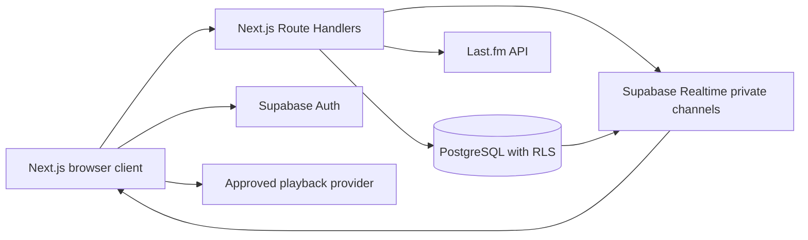

# System Architecture

**Status:** Phase 0 review draft. The owner approved the general Next.js/Supabase direction; provider selection, detailed scope, privacy defaults, and acceptance targets remain open.

## System shape

The diagram shows the proposed boundaries, not an existing implementation. A selected provider may require some operations to run in the browser through its official SDK; provider secrets and server-side signing stay on the server.

## Frontend

- Next.js App Router and TypeScript provide pages, layouts, and server Route Handlers.
- Tailwind CSS, Framer Motion, and Lucide implement the planned visual design and interactions.
- TanStack Query is the proposed home for cached server data; Zustand is for transient interface state such as open panels and local player presentation state. Do not mirror authoritative room state into an independent client-only source of truth.
- UI components consume domain-facing room, account, and provider contracts rather than embedding vendor calls in page components.
- Playback controls must be capability-aware. Unsupported seek, repeat, volume, or output controls are unavailable, not no-op buttons.
- Follow reduced-motion preferences, keyboard and screen-reader accessibility, and responsive desktop/mobile layouts.

## Backend and integrations

- Supabase Auth manages LOKI identity and sessions.
- Next.js Route Handlers handle callbacks, provider token exchange/signatures, account linking, and validated room commands.
- Last.fm is a distinct metadata/scrobbling adapter. Its API secret and user session keys never reach browser code. The web authorization flow and API method signatures are Last.fm-specific; do not label it standard OAuth without qualification. Last.fm asks developers to contact its partners team before commercial or research use: <https://www.last.fm/api/intro>.
- A future `MusicProvider` boundary maps provider track IDs, availability, authentication, playback state, supported controls, and errors. It must also disclose provider capabilities and terms constraints.
- Provider audio is played only via the official SDK/player or a stream endpoint whose license/terms permit that use. No extraction, hidden endpoints, or proxy workaround.
- Vercel is the initial frontend deployment target; Supabase is the initial managed backend. Keep deployment assumptions isolated, but do not build an expensive generic hosting abstraction before there is a real alternative requirement.

## Server-authoritative room playback

Persist one playback-state row per room with fields equivalent to:

- room ID and monotonic revision/version;
- provider key and provider track ID;
- queue item ID;
- `is_playing`, `position_ms`, and server `anchor_at` timestamp;
- current controller and update timestamp;
- repeat/shuffle modes only when supported by the provider.

The server does not stream the audio. A controller command is authenticated, authorized against current membership/role, validated against provider capabilities, and committed atomically. The update includes an idempotency or revision check so a stale/retried command cannot silently overwrite newer state. After commit, Realtime distributes the new state/event. Clients estimate position from the server timestamp, compare it with actual provider state, and correct drift only where provider policy and controls allow it.

Use Realtime for room state changes, chat notifications, and presence. PostgreSQL is the recoverable source of truth. A reconnecting client fetches the current room snapshot before applying later events. Broadcast payloads contain only data authorized for the channel; do not treat broadcast authorization as playback-command authorization.

## Initial database model

Use UUID primary keys, foreign keys, timestamps, check constraints, and indexes aligned to query/RLS predicates. Proposed entities:

| Entity | Purpose and initial constraints |
|---|---|
| `profiles` | LOKI profile keyed to `auth.users`; unique normalized username; visibility/preferences; no provider credentials. |
| `connected_accounts` | Provider identity and linkage metadata. Token/session secrets are encrypted and never client-readable; provider and external subject are unique per user. |
| `listening_rooms` | Owner, public/private visibility, descriptive fields, max participants, guest/control/queue settings, lifecycle. Store room password hashes and invitation-token hashes only. |
| `room_memberships` | `(room_id, user_id)` uniqueness, membership status, joined/left timestamps, one current role (`owner`, `dj`, `listener`). A role column is sufficient for one active role per membership; split roles only if future permissions need multiple grants. |
| `room_control_requests` | Requester, requested role/control, state, approver, decision timestamps, cooldown/duplicate constraints. |
| `room_playback_states` | One row per room, provider track reference, position anchor, play state, controller, queue item, revision, update time. |
| `room_queue_items` | Room, provider and track IDs, ordering token, adder, status, timestamps; index by `(room_id, order_token)`. Queue edits are transactional. |
| `room_messages` | Room, author, body, timestamps, moderation/deletion state; index `(room_id, created_at)`. |
| `friend_requests` / `friends` | Directed requests with unique pending pair; accepted relationship represented once with canonical user ordering. |
| `notifications` | Recipient, type, source IDs, read state, creation time; index `(user_id, created_at)` and unread access path. |
| `listening_history` | User, provider track identity, observed start/duration, scrobble status; define retention and deduplication before migration. |
| `blocked_users` | Directed block relationship, unique `(blocker_id, blocked_id)`, no self-block. |
| `reports` | Reporter, target, reason, state, timestamps; visible only to the reporter and authorized moderators. |
| `user_preferences` | Small user-owned settings not already represented on `profiles`. |

Artwork uploads, if implemented, use object storage with explicit upload size/type checks and policies. Provider artwork is hotlinked or cached only as provider terms allow.

## Authorization model

| Action | Required authorization |
|---|---|
| View public room listing | Public-safe room fields only; do not expose private room settings or invitation data. |
| View private room details/state/chat | Active membership, or a narrow invite/join flow that reveals no room content before admission. |
| Join/leave room | Authenticated user; server validates room visibility, guest setting, invite/password, ban/block policy, and capacity. |
| Change room settings/delete/transfer ownership | Current room owner; server-side check and transaction. |
| Playback/queue commands | Current owner/DJ/controller, or a specifically permitted listener command; server validates current role, provider capability, rate limit, and room state. |
| Request control | Active listener; enforce per-user/room cooldown and deduplicate pending requests. |
| Send/read chat | Active member; validate length and rate; read scope cannot reveal other rooms. |
| Read/edit profile | Apply the chosen public/friends/private setting; owner can edit only their profile. |
| Read provider credentials | Server-only integration paths; no direct client access to token rows. |

Enable RLS on every exposed table and set grants as well as policies. Supabase notes that RLS policies do not remove existing table grants. Use small per-operation policies and test both allow and deny cases. Keep any `SECURITY DEFINER` function narrowly scoped, schema-qualified, and pinned to a safe `search_path`; validate caller identity and room role inside the same transaction as the mutation.

For Realtime, use private room topics and `realtime.messages` policies that check active membership. Membership changes, bans, and role revocation must take effect for both database reads and realtime subscriptions. Use database Broadcast for persisted state-change fan-out where suitable; use ephemeral Broadcast for transient notifications only when losing them is acceptable.

## Authentication and provider account linking

- LOKI sign-in is through Supabase Auth; server requests verify the user session before any private operation.
- OAuth-style provider linking uses state/CSRF protection, exact callback validation, short-lived codes, least scopes, token rotation, disconnect/revocation, and provider-specific error handling.
- Last.fm uses its API key/secret and session exchange; its API secret is server-only. Store user session keys encrypted with restrictive server-only access.
- Playback-provider access must use its official documented authorization and browser/server SDK. Do not assume a user's metadata account grants streaming rights.

## Failure and recovery

Represent provider errors, missing local entitlement, region unavailability, expired credentials, autoplay rejection, and unsupported tracks separately. If a participant cannot play the track, show the limitation and leave room state honest; do not show them as synchronized when they are not. On reconnect, reload the room snapshot, revalidate membership, and only then subscribe/apply events.

## Test and deployment strategy

- Unit tests for domain permission rules, provider capability mapping, timeline math, and idempotency.
- Supabase database tests for RLS and authorization allow/deny cases; Supabase recommends `supabase test db` as part of securing exposed tables: <https://supabase.com/docs/guides/database/postgres/row-level-security>.
- Integration tests for provider login, callbacks, expiry, playback state, scrobble threshold, and provider error paths using official test/sandbox facilities where available.
- Browser end-to-end tests with at least two independent authenticated sessions for room join, control approval, queue mutation, late join, drift recovery, and unauthorized-command rejection.
- Deployment uses environment variables/managed secrets, database migrations, security headers, health/error logging with secret redaction, and a documented self-host setup.

## Dependencies

Identity and membership precede private room access. Provider selection and a successful playback spike precede room synchronization acceptance. Room state and membership precede DJ control and shared queue; identity/privacy precede social presence and notifications. Security and access tests are cross-cutting from the first migration onward.
